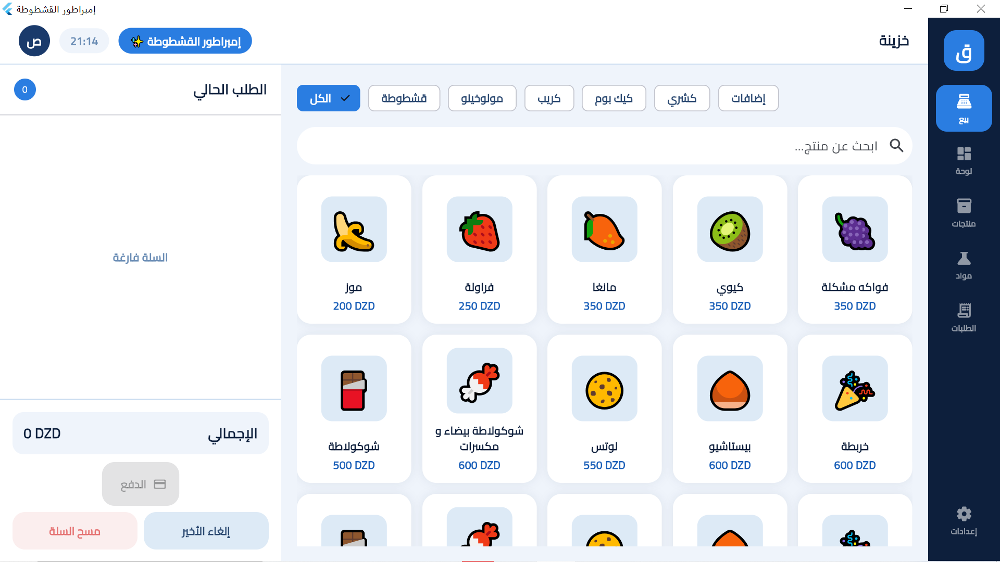
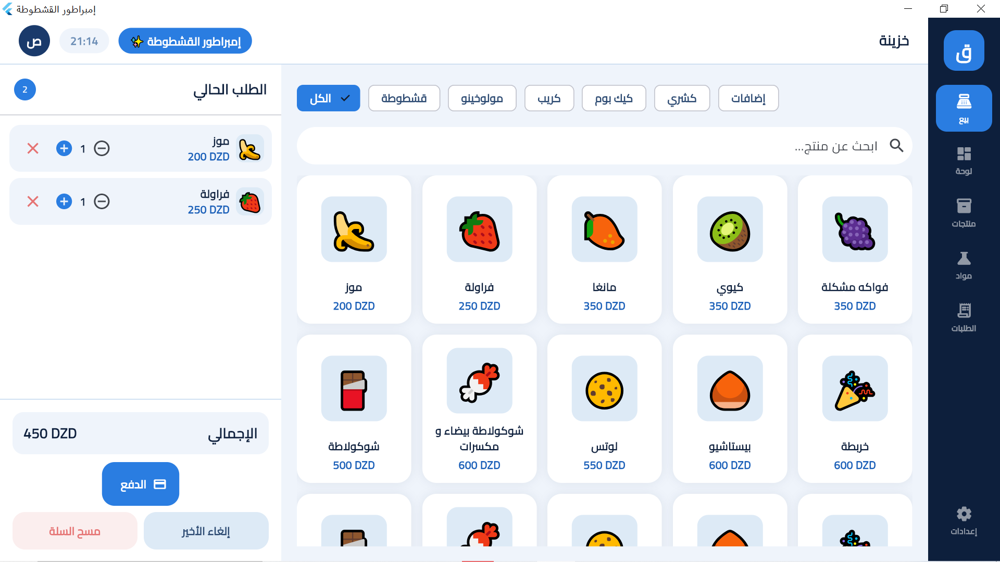
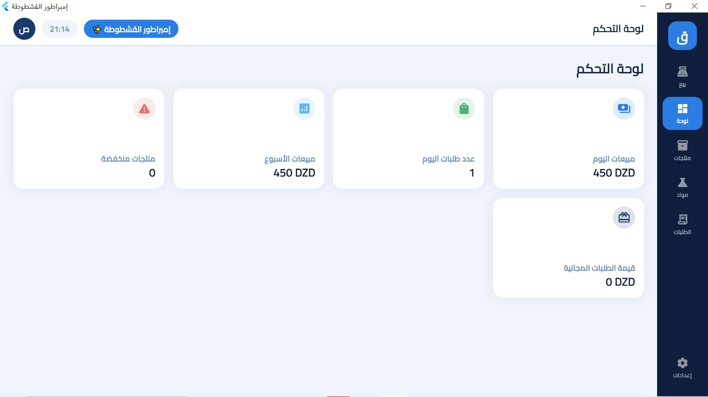
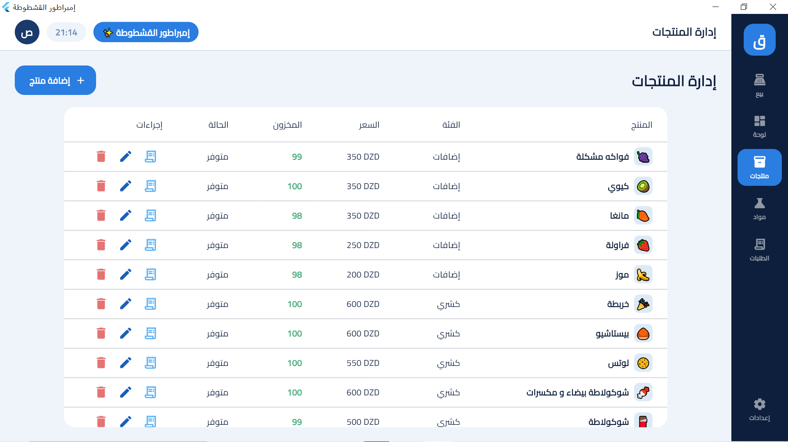
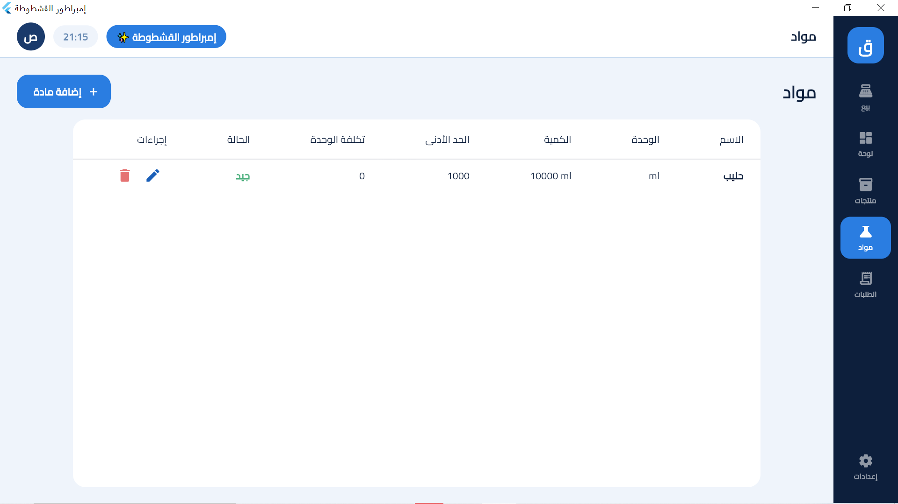
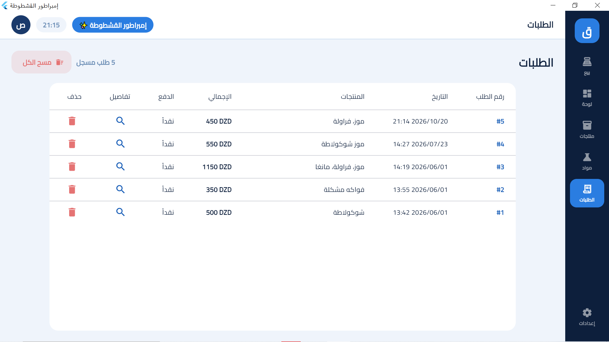

# Qashtota POS Flutter Desktop
# Qashtota POS

A comprehensive Point of Sale (POS) desktop application built with Flutter and SQLite. Designed for efficient local order management, stock tracking, and receipt printing.

## 📸 Screenshots

| Dashboard / Home | POS Interface |
|-----------|---------------|
|  |  |
|  |  |
|  |  |

*(Add more rows or images as needed)*

## ✨ Features
* **Interactive POS Screen:** Streamlined checkout and order processing.
* **Order Management:** Track and manage customer orders seamlessly.
* **Inventory & Stock:** Monitor supplies and product stock levels.
* **Local Database:** Fast, robust offline data storage using `sqflite`.
* **Receipt Printing:** Integrated receipt generation and printing services.

## 🚀 Getting Started

### Prerequisites
* [Flutter SDK](https://flutter.dev/docs/get-started/install) installed.
* Windows desktop development tools configured.

### Running the App
Clone the repository, navigate to the project folder, and run the desktop application:

```bash
flutter pub get
flutter run -d windows


